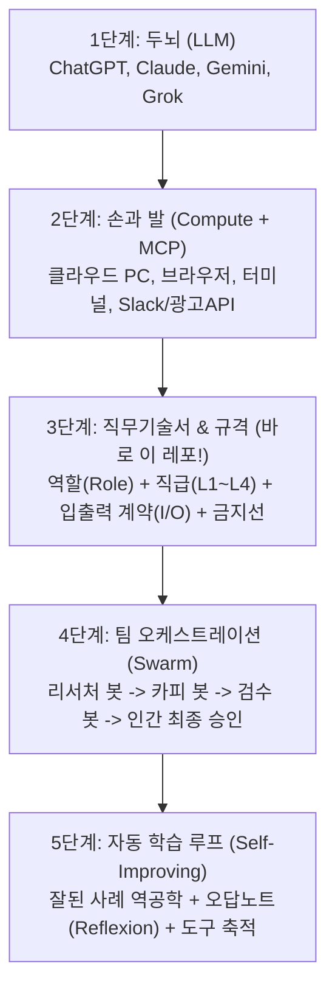
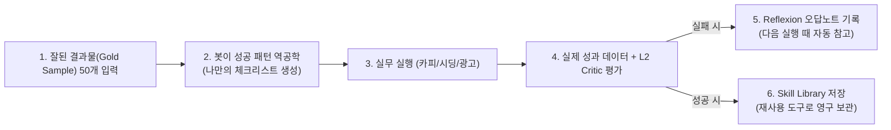

# 🎓 AI 에이전트 조직 설계 & 오케스트레이션 입문 커리큘럼 (`STUDY_CURRICULUM.md`)

> **이 문서를 만든 이유:**
> 봇에게 **직무기술서(JD)**와 **클라우드 컴퓨터(브라우저·터미널·API)**를 쥐어주고, 여러 봇을 팀으로 묶어 실무를 돌리는 **"AI 에이전트 회사"**를 설계하기 위한 **비전공자·초보자 친화형 2주 학습 로드맵**입니다.
>
> 복잡한 수학이나 머신러닝 이론은 뺐습니다. **"내가 직접 코딩하지 않고, 디지털 직원들의 감독(아키텍트)이 되는 법"**에 집중합니다.

- [🏠 메인 README로 돌아가기](README.md)
- [📱 18개 직무 모바일 리더 보기](MOBILE_READER.md)

---

## 🗺️ 먼저 보는 큰 그림 (Big Picture)

우리가 만든 레포지토리(`agent-job-descriptions`)가 전체 AI 에이전트 생태계에서 어디에 위치하는지 한눈에 보세요.

**핵심 깨달음 하나만 잡고 가세요:**
* 예전의 AI(ChatGPT 채팅)는 **"말만 잘하는 자문위원"**이었습니다.
* 앞으로의 AI(그록봇, ChatGPT Dot, Claude Code 등)는 **"자기 컴퓨터를 지급받은 디지털 직원"**입니다.
* 직원에게 컴퓨터만 사주고 *"알아서 회사 매출 올려"*라고 하면 100% 헤맵니다. **직무기술서(JD), 보고 체계(L1~L4), 주고받을 문서 양식(I/O)**을 줘야 비로소 팀처럼 움직입니다. 우리가 방금 만든 18개 직무 파일이 바로 그 설계도입니다.

---

## 📅 2주 완주 커리큘럼 (하루 20~30분, 모바일 읽기용)

---

### 🟢 Level 1 (1~2일차): 챗봇과 ‘컴퓨터 가진 에이전트’는 무엇이 다른가?

#### 💡 쉬운 비유
* **챗봇(Chatbot):** 질문하면 답장만 보내주는 **똑똑한 전화 상담원**. 엑셀 파일을 직접 열어 수정하거나 웹사이트에 로그인해서 광고를 세팅하지 못합니다.
* **에이전트(Agent):** 책상·노트북·메신저 아이디·법인가드 한도(권한)를 부여받고, **목표를 달성할 때까지 스스로 검색→시도→오류 수정→보고**를 반복하는 **신입사원**입니다.

#### 🔑 꼭 알아야 할 핵심 단어 3개만
1. **샌드박스 (Sandbox):** 봇에게 지급된 전용 클라우드 컴퓨터(리눅스 가상 PC). 여기서 봇이 파이썬을 돌리고 파일을 만듭니다.
2. **MCP (Model Context Protocol):** 봇의 USB 포트. 봇에게 Google Analytics, Slack, Notion, Meta 광고 관리자 같은 외부 툴을 꽂아주는 표준 연결 규격입니다.
3. **워크플로우 vs 에이전트:**
   * **워크플로우(Workflow):** "매일 아침 9시에 A 사이트 긁어서 슬랙에 보내"처럼 순서가 100% 정해진 자동화.
   * **에이전트(Agent):** "경쟁사 신제품 반응 조사해서 보고서 써와"라고 목표만 주면, 봇이 스스로 판단해 도구를 골라 쓰는 방식.

#### 🚫 이건 몰라도 됩니다! (포기 방지)
* LLM 모델 내부의 트랜스포머(Transformer), 어텐션(Attention) 수식, 파이토치(PyTorch) 모델 학습 코드는 **전혀 몰라도 됩니다.** 우리는 모델을 만드는 사람이 아니라 **이미 똑똑한 모델을 채용해 부리는 CEO/아키텍트**입니다.

#### 📚 추천 학습 출처 (1~2일차)
1. **[필독 블로그] Anthropic — Building Effective Agents**
   * 👉 https://www.anthropic.com/research/building-effective-agents
   * *보는 법:* 영어 페이지지만 모바일 브라우저 번역기로 읽으시면 됩니다. 특히 **5가지 패턴 그림**(Routing, Parallelization, Orchestrator-Workers, Evaluator-Optimizer)만 눈으로 익히세요. 우리가 만든 `L1~L4` 체계가 바로 여기서 나왔습니다.
2. **[입문 영상] Andrej Karpathy — Intro to Large Language Models (1시간)**
   * 👉 https://www.youtube.com/watch?v=zjkBMFhNj_g
   * *보는 법:* 전 OpenAI/테슬라 AI 수장이 비전공자도 이해할 수 있게 설명한 전설적 강의입니다. 뒷부분의 **Tool Use & OS로서의 LLM** 파트를 보면 왜 봇에게 컴퓨터 자원이 주어지는지 단번에 이해됩니다.
3. **[공식 문서] Model Context Protocol (MCP) 소개**
   * 👉 https://modelcontextprotocol.io/docs/2026-07-28/getting-started/intro
   * *보는 법:* 첫 페이지의 개념 그림만 보고 "아, 봇한테 사내 툴을 꽂아주는 표준 규격이구나" 정도만 이해하고 넘어가세요.

---

### 🟡 Level 2 (3~5일차): 왜 봇을 ‘혼자’ 두지 말고 ‘팀(조직)’으로 묶어야 할까?

#### 💡 쉬운 비유
아무리 천재 직원이라도 혼자서 **시장조사 + 브랜드 기획 + 카피 20개 작성 + 이미지 디자인 + 광고 세팅 + 데이터 검증**을 한꺼번에 시키면 어떻게 될까요?
중반쯤 가면 처음에 줬던 브랜드 가이드라인을 까먹고, 막히면 대충 그럴듯한 가짜 결과물을 만들어 놓고 *"다 했습니다!"*라고 보고합니다.

실제로 미국 카네기멜론대(CMU) 연구진이 봇에게 컴퓨터와 사내 메신저를 주고 실제 회사 업무 175개를 혼자 처리하게 시켰더니 **성공률이 고작 24~30% 수준**이었습니다.

#### 🔑 이 문제를 푸는 3가지 조직 설계 공식 (우리가 레포에 반영한 것)

1. **바통 터치 규격(`io_contract`) 강제하기 — MetaGPT의 교훈**
   * 봇끼리 "대충 알아서 대화해"라고 하면 끝없이 수다만 떱니다.
   * 대신 인간 회사처럼 **직무별로 짧은 일만 맡기고, 정해진 문서 양식(JSON/YAML/MD)으로만 바통을 넘기게** 만들면 성공률이 급상승합니다.
2. **만드는 봇(`L1 Worker`)과 까는 봇(`L2 Critic`)을 분리하기**
   * 자기가 쓴 글을 자기가 검수하면 무조건 통과시킵니다.
   * 반드시 **"브랜드 톤앤매너와 팩트만 냉정하게 깎아내리는 검수 전문 봇(Critic)"**을 따로 두어, 반려(Reject)와 수정 지시를 내리게 해야 실무 퀄리티가 나옵니다.
3. **돈·법·대외 발송 앞에는 인간 승인(`HITL: Human-in-the-Loop`) 버튼 두기**
   * 조사·기획·초안 제작·스테이징 세팅까지는 밤새 봇들이 95% 자율로 끝내고, **실제 광고비 결제·대량 메일 발송·보도자료 배포** 버튼만 아침에 사람이 스마트폰으로 누릅니다.

#### 🚫 이건 몰라도 됩니다! (포기 방지)
* LangGraph의 복잡한 상태 머신(StateGraph) 파이썬 코드나 Docker 컨테이너 네트워크 설정은 지금 외우지 마세요. **"어떤 직무 봇이 누구에게 어떤 문서를 넘기는지(흐름도)"**만 머리에 그리시면 됩니다.

#### 📚 추천 학습 출처 (3~5일차)
1. **[가상 회사 실험] CMU — TheAgentCompany (디지털 직원 벤치마크)**
   * 👉 사이트: https://the-agent-company.com/
   * 👉 논문: https://arxiv.org/abs/2412.14161
   * *보는 법:* 웹사이트 첫 화면에서 *"봇들이 가상 회사(GitLab, 메신저, 파일서버)에서 어떻게 일하다가 실패하는지"* 사례와 성공률 그래프만 훑어보세요. 왜 직무 분리와 명확한 지시서가 필요한지 체감됩니다.
2. **[SOP 멀티에이전트] MetaGPT (GitHub)**
   * 👉 https://github.com/FoundationAgents/MetaGPT
   * *보는 법:* README 상단의 **"Code = SOP(Team)"** 개념도와 역할 분담 그림만 보세요. *"소프트웨어 회사(PM → 아키텍트 → 엔지니어 → QA)를 그대로 봇 팀으로 복제한다"*는 발상이 우리가 만든 마케팅/비즈니스 18대 직무와 똑같습니다.
3. **[컴퓨터 샌드박스 오픈소스] OpenHands (구 OpenDevin)**
   * 👉 https://github.com/OpenHands/OpenHands
   * *보는 법:* 에이전트에게 리눅스 터미널·브라우저·에디터를 쥐어주는 대표 오픈소스입니다. "아, 요즘 봇들은 이런 작업실(Workspace) 안에서 일하는구나" 정도만 구경하세요.
4. **[참고 프레임워크] CrewAI / LangGraph**
   * CrewAI (역할극 기반 팀): https://github.com/crewAIInc/crewAI
   * LangGraph (그래프 기반 정밀 제어): https://github.com/langchain-ai/langgraph
   * *보는 법:* 코드보다 README에 있는 "Role + Goal + Backstory + Tools" 구조가 우리가 만든 `.agent.yaml` 스펙과 어떻게 1:1로 대응되는지 비교해 보세요.

---

### 🟠 Level 3 (6~9일차): "내가 실무 전문가가 아니어도 봇이 암묵지를 학습하게 만드는 법"

사용자가 가장 걱정하셨던 질문입니다:
> *"마케터나 영업 고수가 아니면 실무의 디테일과 암묵지를 봇한테 어떻게 가르치지?"*

정답은 **"내가 직접 가르치지 말고, 봇이 스스로 시장에서 배우고 오답노트를 쓰게 시스템을 짜주는 것"**입니다. 이를 가능하게 하는 4가지 핵심 메커니즘을 공부하세요.

#### 🔑 암묵지 극복을 위한 4가지 무기
1. **역공학 (Reverse Engineering):** 내가 카피 쓰는 법을 몰라도, 봇에게 *"경쟁사 메타 광고 라이브러리에서 30일 이상 살아남은(잘 팔리는) 광고 50개를 긁어와서, 왜 잘 팔리는지 훅/논리/CTA 패턴을 추출해"*라고 시키면 봇이 스스로 고수의 규칙을 만들어냅니다.
2. **Reflexion (언어적 오답노트):** 봇이 실행에 실패하거나 CTR이 낮게 나오면, 그 이유를 스스로 글로 반성해 `lessons_learned.md`에 저장하게 합니다. 다음 작업 시 그 노트를 먼저 읽고 시작하므로 **AI 모델을 재학습하지 않고도 실력이 계속 늡니다.**
3. **Skill Library (Voyager 방식의 무기 창고):** 봇이 한 번 시행착오 끝에 성공한 크롤링 코드, 보고서 템플릿, 아웃바운드 시퀀스를 버리지 않고 `skills/` 폴더에 저장해 재사용합니다.
4. **자동 프롬프트 최적화 (DSPy / TextGrad):** 사람이 밤새 프롬프트를 깎는 대신, 실제 성과 지표(오픈율, 전환율, 테스트 통과율)를 점수로 연결해 AI가 자신의 직무기술서 프롬프트를 스스로 고쳐 나가게 만듭니다.

#### 🚫 이건 몰라도 됩니다! (포기 방지)
* TextGrad의 미분(Gradient) 수학 공식이나 DSPy의 텔레프롬프터(Teleprompter) 내부 알고리즘은 알 필요 없습니다. **"봇에게 오답노트 폴더(`memory/`)와 성공 도구 폴더(`skills/`)를 만들어주면 봇이 알아서 성장한다"**는 원리만 기억하세요.

#### 📚 추천 학습 출처 (6~9일차)
1. **[스킬 라이브러리 원조] Voyager (NVIDIA / Caltech 등)**
   * 👉 https://voyager.minedojo.org/
   * *보는 법:* 마인크래프트 게임 속에서 봇이 아무것도 안 가르쳐줘도 스스로 탐험하며 **"성공한 행동 코드를 스킬 라이브러리에 저장하고 조합해 더 어려운 일을 해내는 영상/그림"**만 보세요. 10분이면 개념이 완전히 잡힙니다.
2. **[오답노트 학습] Reflexion 논문**
   * 👉 https://arxiv.org/abs/2303.11366
   * *보는 법:* Abstract(요약)와 첫 페이지 개념도만 보세요. *"실패한 궤적을 텍스트 반성문(Verbal Reflection)으로 바꿔 메모리에 넣었더니 다음 시도에 성공률이 수직 상승했다"*는 내용입니다.
3. **[프롬프트 자동 진화] DSPy & TextGrad (참고용)**
   * DSPy: https://github.com/stanfordnlp/dspy
   * TextGrad: https://github.com/zou-group/textgrad
   * *보는 법:* "앞으로 프롬프트 엔지니어링도 사람이 손으로 쓰는 게 아니라, 지표(KPI) 기반으로 AI가 자동 컴파일·최적화하는 시대로 가는구나" 정도로 방향성만 파악하세요.

---

### 🔴 Level 4 (10~14일차): 내가 만든 레포지토리(`agent-job-descriptions`)로 첫 실전 팀 가동하기

이론을 다 이해했다면, **18개 직무를 한 번에 다 띄우려고 하지 마세요.** 100% 지칩니다.
가장 작고 즉각적인 성과가 나오는 **3인 미니 스쿼드(3-Agent Pod)**부터 시작해 하나씩 붙이세요.

#### 🐣 1단계: 가장 쉬운 ‘3인 마케팅 스쿼드’부터 테스트하기
지금 쓰시는 에이전트(Antigravity, Claude Code, Codex 등)에게 우리 레포지토리의 스펙 파일 3개만 읽히고 일을 시켜보는 겁니다.

1. **시장 리서처 (`specs/marketing/market-trend-consumer-researcher.agent.yaml`, `L1`):**
   * *시킬 일:* "우리 타겟 시장 경쟁사 3곳의 랜딩페이지와 리뷰 50개를 조사해서 `icp_personas.json` 양식으로 뽑아줘."
2. **카피·콘텐츠 (`specs/marketing/content-copywriter-creative.agent.yaml`, `L1`):**
   * *시킬 일:* "방금 리서처가 만든 `icp_personas.json`을 읽고, 광고 카피 10종을 `ad_copy_matrix.json`으로 써줘."
3. **브랜드 전략가 (`specs/marketing/brand-marketer-strategist.agent.yaml`, `L2 Critic`):**
   * *시킬 일:* "카피 10종 중에서 과장 광고이거나 우리 브랜드 톤에 안 맞는 걸 냉정하게 탈락시키고, 1~3등만 이유와 함께 뽑아줘."

#### 🚀 2단계: 성과 확인 후 하나씩 직원 추가 채용하기
* 3인 스쿼드가 깔끔하게 돌아가면 → **`인플루언서 시딩 봇`** 추가 (크리에이터 리스트업 & 맞춤 메일 초안)
* 그다음 → **`퍼포먼스 그로스 봇` + `데이터 애널리스트 봇`** 연결 (소재 성과 분석 → 카피 봇에게 자동 피드백)
* 마지막으로 → **`CMO (L4)`** 오케스트레이터가 전체 예산을 배분하도록 승격

#### 📌 향후 에이전트 기술이 나아가는 방향 (2026~2028 로드맵)
1. **단일 챗봇 → 상시 가동 데몬(Daemon) 조직:** 사용자가 채팅창에 물어볼 때만 일하는 봇이 아니라, 클라우드 서버에서 24시간 돌면서 매일 아침 리포트·시딩·이상탐지를 끝내고 **슬랙/카톡으로 승인만 요청하는 상주 팀**으로 이동합니다.
2. **프롬프트 엔지니어링 → 컨텍스트 & 조직 엔지니어링:** 누가 프롬프트를 한 줄 더 잘 쓰느냐가 아니라, **누가 더 정확한 직무기술서(`Spec`), 도메인 오버레이(`Overlay`), 검수 루프(`Critic`), 사내 툴(`MCP`)을 조립해 두었느냐**가 경쟁력이 됩니다.
3. **완전 자율의 임계점:** 현재는 단기 과업(수십 분~수 시간)은 완전 자율이 가능하고, 장기 전략(수주~수개월)은 인간이 중간 승인(`HITL`)을 쥐는 **하이브리드 자율 회사**가 가장 현실적이고 강력한 형태입니다.

---

## ✅ 오늘부터 바로 실천할 체크리스트

- [ ] **1일차:** Anthropic *Building Effective Agents* 글의 그림 5개만 훑어보기
- [ ] **3일차:** 내 레포지토리의 [`MOBILE_READER.md`](MOBILE_READER.md)에서 관심 있는 직무 3개(`리서처`, `카피라이터`, `퍼포먼스`) 펼쳐 읽기
- [ ] **5일차:** [`workflows/full-marketing-engine.yaml`](workflows/full-marketing-engine.yaml) 흐름을 보며 내 비즈니스에 필요한 최소 3개 에이전트 고르기
- [ ] **7일차:** `overlays/domains/` 중 내 사업 도메인 파일 1개 열어 내 실제 브랜드/제품 조건으로 커스터마이징해 보기
- [ ] **10일차:** 집 PC에서 `aside` CLI 세팅 후 `python3 scripts/retry_with_aside.py`로 남은 공고 마저 수집하기
